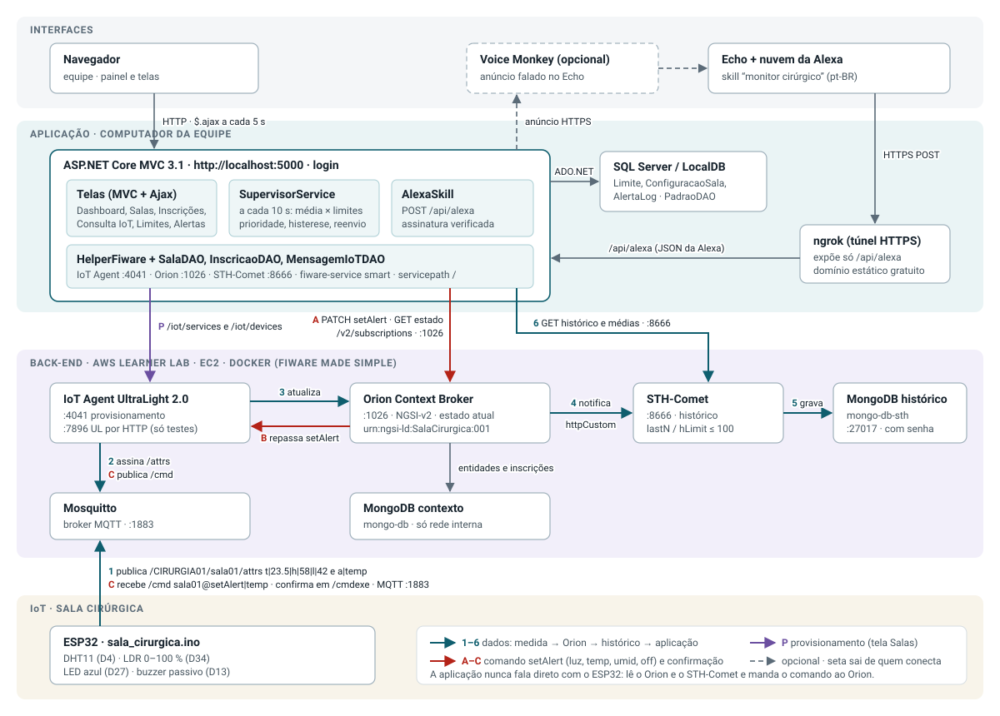
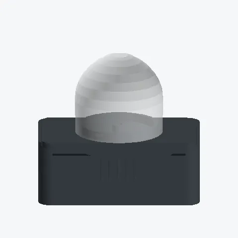

# Monitor de Sala Cirúrgica

Sistema de supervisão para IoT que mede **temperatura, umidade e luminosidade** de uma sala cirúrgica com um **ESP32**, envia as medidas para uma plataforma **FIWARE** na AWS, guarda o histórico e reage a valores fora dos limites com **alerta visual (LED azul piscando) e sonoro (buzzer)**.

Projeto **N2** de **Sistemas Embarcados** (Prof. Fábio Henrique Cabrini) e **Linguagem de Programação I** (Prof. Eduardo Rosalém) · Engenharia de Computação · Faculdade Engenheiro Salvador Arena (FESA).

---

## Integrantes

| Nome | RA |
| --- | --- |
| André Felipe Teixeira Gomes | 082240018 |
| Arthur Marassatto | 082240025 |
| Danilo Spinola Mota Batista | 082240002 |
| Enzo Molinari Ferreira | 082240003 |
| Guilherme Eidi Tiba | 082240026 |

O trabalho está dividido em duas frentes, como descrito no Guia dos desenvolvedores: **servidor** (aplicação ASP.NET Core, banco SQL, FIWARE na AWS e diagrama da arquitetura) e **dispositivo** (firmware do ESP32, circuito, montagem e caixa impressa em 3D).

## Sumário

- [Objetivo](#objetivo)
- [Arquitetura](#arquitetura)
- [Componentes e pinagem](#componentes-e-pinagem)
- [Limites e tabela de alertas](#limites-e-tabela-de-alertas)
- [Firmware do ESP32](#firmware-do-esp32)
- [Aplicação e banco de dados](#aplicação-e-banco-de-dados)
- [Deploy no AWS Learner Lab](#deploy-no-aws-learner-lab)
- [Como executar](#como-executar)
- [Estrutura do repositório](#estrutura-do-repositório)
- [Documentação complementar](#documentação-complementar)

---

## Objetivo

Supervisionar em tempo real a temperatura, a umidade e a luminosidade de uma sala cirúrgica, guardar o histórico e reagir a valores fora dos limites com alertas visuais e sonoros, usando a API do FIWARE numa instância EC2 do AWS Learner Lab.

O ciclo completo:

1. O **ESP32** lê o DHT11 (temperatura e umidade) e o LDR (luminosidade em 0–100 %) a cada 5 s e publica as três medidas por **MQTT** no IoT Agent.
2. O **IoT Agent UltraLight** traduz a mensagem para NGSI-v2 e atualiza a entidade no **Orion Context Broker** (estado atual).
3. O **Orion** notifica o **STH-Comet**, que persiste as séries no **MongoDB** (histórico).
4. A **aplicação ASP.NET Core** lê o estado no Orion, calcula a **média da janela** no STH-Comet, compara com os limites do perfil ativo e, quando alguma grandeza sai da faixa, envia o comando `setAlert` ao Orion.
5. O Orion repassa o comando ao IoT Agent, que o publica em `/CIRURGIA01/sala01/cmd`. O **ESP32 obedece**: pisca o LED azul e toca o buzzer num padrão próprio de cada grandeza. Com as três grandezas dentro dos limites, LED e buzzer ficam desligados.

> **Quem decide o alerta é a aplicação; o ESP32 só mede e obedece.** A aplicação nunca fala direto com o ESP32.

## Arquitetura



Diagrama em [`docs/arquitetura.svg`](docs/arquitetura.svg), com as explicações camada por camada em [`arquitetura.md`](docs/arquitetura.md). A seta parte sempre de quem inicia a conexão (padrão do FIWARE Made Simple).

### Camadas, componentes e portas

| Camada | Onde roda | Componentes | Portas |
| --- | --- | --- | --- |
| **IoT** | Sala cirúrgica | ESP32 DevKit V1: DHT11, LDR, LED RGB (só o azul), buzzer passivo | cliente MQTT → 1883 |
| **Back-end** | EC2 do AWS Learner Lab, Docker (FIWARE Descomplicado) | Mosquitto, IoT Agent UltraLight, Orion, STH-Comet, MongoDB de contexto (rede interna) e MongoDB de histórico (com senha) | 1883, 1026, 4041, 8666, 27017, 7896 (só testes) |
| **Aplicação** | Computador da equipe | ASP.NET Core MVC 3.1 (telas, `SupervisorService`, skill da Alexa) e SQL Server / LocalDB | 5000 (local) |
| **Interfaces** | Navegador e Echo | Dashboard e telas; skill da Alexa por túnel ngrok; anúncios opcionais (Voice Monkey) | HTTPS 443 |

### Fluxo de dados (1 → 6)

| # | De → para | Protocolo / porta | O que passa |
| --- | --- | --- | --- |
| 1 | ESP32 → Mosquitto | MQTT :1883 | `/CIRURGIA01/sala01/attrs` · `t\|23.5\|h\|58\|l\|42` a cada 5 s, e `a\|temp` quando o alerta muda |
| 2 | IoT Agent → Mosquitto | MQTT :1883 | assina `/+/+/attrs` e traduz UltraLight → NGSI-v2 |
| 3 | IoT Agent → Orion | HTTP :1026 | atualiza `temperature`, `humidity`, `luminosity` e `alert` na entidade `urn:ngsi-ld:SalaCirurgica:001` |
| 4 | Orion → STH-Comet | HTTP :8666 `/notify` | inscrição em `httpCustom` (NGSIv1), uma por grandeza |
| 5 | STH-Comet → MongoDB | :27017 | grava a série em `sth_smart` e agrega por minuto, hora e dia |
| 6 | Aplicação → STH-Comet | HTTP :8666 | histórico dos gráficos, consulta paginada e média da janela da supervisão |

### Fluxo de comandos (A → C)

| # | De → para | Protocolo / porta | O que passa |
| --- | --- | --- | --- |
| — | `SupervisorService` | interno, a cada 10 s | média da janela × limites do perfil (com histerese) → alerta de maior prioridade |
| A | Aplicação → Orion | HTTP :1026 | `PATCH /v2/entities/urn:ngsi-ld:SalaCirurgica:001/attrs` com `setAlert` = `luz`, `temp`, `umid` ou `off` |
| B | Orion → IoT Agent | HTTP :4041 | o IoT Agent é o provedor do comando (registro criado no provisionamento) |
| C | IoT Agent → Mosquitto → ESP32 | MQTT :1883 | `/CIRURGIA01/sala01/cmd` · `sala01@setAlert\|temp`; o ESP32 confirma em `/cmdexe` |
| P | Aplicação → IoT Agent | HTTP :4041 | `/iot/services` e `/iot/devices` (tela Salas) |

### Contrato entre firmware, FIWARE e aplicação

| Item | Valor |
| --- | --- |
| `fiware-service` / `fiware-servicepath` | `smart` / `/` |
| apikey · device_id | `CIRURGIA01` · `sala01` |
| Entidade | `urn:ngsi-ld:SalaCirurgica:001`, tipo `SalaCirurgica` |
| Atributos (UltraLight → Orion) | `t` → `temperature` (Number, °C) · `h` → `humidity` (Number, %) · `l` → `luminosity` (Integer, 0–100 %) · `a` → `alert` (Text) |
| Comando | `setAlert` com `luz`, `temp`, `umid` ou `off` |

## Componentes e pinagem

### Lista de materiais

| Componente | Quantidade | Observação |
| --- | --- | --- |
| ESP32 DevKit V1 (ESP32-WROOM-32) | 1 | Wi-Fi 2,4 GHz |
| DHT11 — **módulo de 3 pinos** | 1 | temperatura e umidade; a ordem dos pinos varia de módulo para módulo: siga a marcação impressa (−, +, S) |
| LDR (fotoresistor) | 1 | usado no divisor de tensão com 10 kΩ |
| Resistor 10 kΩ | 1 | divisor do LDR |
| Resistor 220 Ω | 1 | canal vermelho do LED |
| Resistor 100 Ω | 3 | canais verde e azul do LED e buzzer |
| LED RGB de **cátodo comum** | 1 | perna mais longa no GND |
| Buzzer **passivo** | 1 | teste: em 3,3 V direto o passivo fica mudo e o ativo apita — o projeto precisa do passivo |
| Mini protoboard de 170 pontos | 1 | a protoboard grande não cabe na caixa |
| Jumpers macho-macho e fêmea-macho | — | o DHT11 fica fora da protoboard, por jumpers fêmea-macho |

### Pinagem

| Componente | Pino do ESP32 | Ligação |
| --- | --- | --- |
| DHT11 (DATA) | **GPIO 4** (D4) | VCC no **3V3**, GND no **GND**, DATA no **D4** |
| LDR | **GPIO 34** (D34) | **3V3 → LDR → GPIO 34 → resistor 10 kΩ → GND** |
| LED RGB — vermelho | **GPIO 25** (D25) | resistor de 220 Ω; **fica apagado no N2** |
| LED RGB — verde | **GPIO 26** (D26) | resistor de 100 Ω; **fica apagado no N2** |
| LED RGB — azul (o LED de alerta) | **GPIO 27** (D27) | resistor de 100 Ω |
| LED RGB — comum | **GND** | perna mais longa (cátodo comum) |
| Buzzer passivo | **GPIO 13** (D13) | D13 → resistor de 100 Ω → buzzer (+); buzzer (−) no GND |
| LED da placa (status) | GPIO 2 | aceso = conectado ao FIWARE; piscando = offline |

Esquema elétrico e foto da montagem: [`circuito_n2.png`](docs/circuito_n2.png).

Pontos de atenção:

- **Divisor do LDR.** O LDR forma um divisor com o resistor de 10 kΩ: mais luz, tensão maior no pino 34. O firmware lê o ADC de 12 bits (0–4095), tira a média de 8 leituras e converte para 0–100 %. Se ao **cobrir** o sensor a leitura **subir**, o LDR está montado do lado do GND: basta `#define LDR_INVERT true` no `config.h`. O pino 34 é do ADC1 e continua funcionando com o Wi-Fi ligado (o ADC2 não funciona).
- **Cores trocadas.** O firmware faz um teste de ligação ao iniciar: acende vermelho, verde e azul em sequência. Se saírem em outra ordem, os fios do LED estão trocados entre D25, D26 e D27.
- **Buzzer ativo x passivo.** No teste de ligação o buzzer toca três tons (500, 1000 e 2000 Hz). Se os três tiverem o mesmo som, o buzzer é **ativo** e não serve: o projeto precisa do passivo para diferenciar os alertas.

### Caixa impressa em 3D (bônus +2,0)

Três peças sem parafusos, PLA: base e tampa em preto, cúpula em branco. Base 116 × 68 × 46 mm; caixa montada com cerca de 103 mm de altura.



*A caixa montada girando: a animação é renderizada dos próprios STLs e repete os três padrões de alerta do firmware — piscada de 150 ms, 400 ms e 1 s, com 2000, 1000 e 500 Hz no buzzer.*

| Peça | Onde fica o componente | Como prende |
| --- | --- | --- |
| DHT11 | janela de 16,5 × 13 mm na lateral esquerda | a placa desce entre duas guias, com o sensor virado para fora; gota de cola quente |
| Buzzer | frente, à direita, atrás de uma grade de 7 furos | encaixa num anel interno de 12,4 mm |
| LDR | frente, à esquerda, furo de 5,2 mm | passa por dentro, pernas para a mini protoboard |
| LED RGB | centro da tampa, dentro da cúpula | suporte com furo de 4,6 mm; cola quente embaixo |
| ESP32 | berço interno | apoiado nas colunas, USB na abertura da lateral direita |
| Mini protoboard | fundo, lado esquerdo | fita dupla-face que vem nela |

Arquivos: [`hardware/caixa/`](hardware/caixa) — os três STLs, [`COMO_IMPRIMIR.txt`](hardware/caixa/caixa-sala-cirurgica-stl/COMO_IMPRIMIR.txt) com as configurações de fatiamento e a ordem de montagem, o gerador paramétrico [`gerar_stls_n2.py`](hardware/caixa/caixa-sala-cirurgica-stl/gerar_stls_n2.py) e o modelo 3D interativo [`modelo-3d-caixa.html`](hardware/caixa/modelo-3d-caixa.html).

**Modelo 3D interativo.** O arquivo `modelo-3d-caixa.html` traz os próprios STLs embutidos em base64, então não precisa instalar nada: girar com o mouse, zoom, alternar **Montada** e **Aberta** (as três peças separadas), vistas prontas (frente, lateral, topo), o nome de cada abertura da caixa, a simulação dos três alertas e um botão que baixa os STLs com as instruções de impressão em `.zip`. Para abrir, clique em [`modelo-3d-caixa.html`](hardware/caixa/modelo-3d-caixa.html) e depois em **Download** (ou baixe o repositório e dê duplo clique no arquivo). O README não consegue rodar esse script — o GitHub remove JavaScript de Markdown —, por isso aqui em cima fica a animação renderizada a partir dos mesmos STLs.

Atende aos requisitos do bônus: caixa que protege o circuito, **sensores expostos**, **LED visível** pela cúpula e **buzzer audível** com a caixa fechada.

## Limites e tabela de alertas

### Perfis de limites

A supervisão compara a **média da janela** (padrão de 30 s, cerca de 6 medidas) com a faixa do perfil ativo da sala. Para **entrar** em alerta basta a média sair da faixa; para **sair**, a média precisa voltar além da **histerese** — o que evita o alarme ligando e desligando em torno do limite. Exemplo: máximo de 28 °C com histerese de 0,5 liga acima de 28,0 e só desliga em 27,5.

| Perfil | Temperatura | Umidade | Luminosidade | Uso |
| --- | --- | --- | --- | --- |
| **Demonstração** (padrão) | 15 a 28 °C · histerese 0,5 | 30 a 75 % · histerese 2 | 25 a 100 % · histerese 3 | Sala de aula: só a provocação dispara (aquecer ou segurar o DHT11, soprar nele, cobrir o LDR) |
| **Norma NBR 7256** | 18 a 22 °C · histerese 0,5 | 45 a 55 % · histerese 2 | 60 a 100 % · histerese 5 | Faixas de referência de sala cirúrgica. A norma não trata de iluminação: o limite do LDR é definido pela equipe sobre a escala 0–100 % |

Os perfis ficam na tabela `Limite` e são editados na tela **Limites**. O perfil de cada sala é escolhido na tela **Salas**.

### Tabela de alertas

| Alerta | Condição (média da janela) | Prioridade | Piscar do LED azul | Tom do buzzer |
| --- | --- | --- | --- | --- |
| `luz` | luminosidade **abaixo do mínimo** ou acima do máximo do perfil | **1ª** | **150 ms aceso, 150 ms apagado** | **2000 Hz** (agudo, pisca rápido) |
| `temp` | temperatura fora da faixa do perfil | **2ª** | **400 ms aceso, 400 ms apagado** | **1000 Hz** (médio) |
| `umid` | umidade fora da faixa do perfil | **3ª** | **1 s aceso, 1 s apagado** | **500 Hz** (grave, pisca devagar) |
| `off` | as três grandezas dentro da faixa (**normalidade**) | — | **apagado** | **desligado** |

Regras que valem no firmware **e** na aplicação:

- O buzzer toca **enquanto o LED está aceso** e silencia quando o LED apaga — o som acompanha o piscar.
- Com mais de uma grandeza fora ao mesmo tempo, vale a de **maior prioridade**: com luz baixa **e** temperatura alta, a placa mostra `luz`. A aplicação manda apenas o alerta que vale.
- Quando as três voltam para dentro da faixa (respeitada a histerese), o `off` desliga LED e buzzer.
- Os tempos e as frequências estão em três lugares que precisam ficar iguais: `config.h` do firmware, tela **Limites/Alertas** da aplicação e esta tabela (`Contrato.cs` no código).

## Firmware do ESP32

Código: [`firmware/sala_cirurgica/sala_cirurgica.ino`](firmware/sala_cirurgica/sala_cirurgica.ino), com a configuração em [`config.h`](firmware/sala_cirurgica/config.h) e o modelo de segredos em [`secrets.example.h`](firmware/sala_cirurgica/secrets.example.h). O código é comentado por seção: pinos, conversão do LDR, tópicos MQTT e tratamento dos comandos.

### Mensagens MQTT

| Direção | Tópico | Exemplo |
| --- | --- | --- |
| ESP32 publica, a cada 5 s | `/CIRURGIA01/sala01/attrs` | `t\|23.5\|h\|58\|l\|42` |
| ESP32 publica, ao mudar e a cada 30 s | `/CIRURGIA01/sala01/attrs` | `a\|luz` |
| ESP32 recebe | `/CIRURGIA01/sala01/cmd` | `sala01@setAlert\|temp` |
| ESP32 confirma | `/CIRURGIA01/sala01/cmdexe` | `sala01@setAlert\|ok temp` |

A confirmação em `/cmdexe` é o que muda `setAlert_status` de `PENDING` para `OK` no Orion — é assim que a aplicação sabe que a placa realmente obedeceu.

### Como gravar

1. Arduino IDE com o pacote **esp32 by Espressif Systems** (versão 2.x ou 3.x) e as bibliotecas **PubSubClient** (Nick O'Leary), **DHT sensor library** e **Adafruit Unified Sensor** (Adafruit).
2. Copiar `secrets.example.h` para `secrets.h` e preencher o Wi-Fi (**2,4 GHz**) e o `MQTT_BROKER` com o IP público da EC2 da sessão.
3. Abrir `sala_cirurgica.ino`, escolher **ESP32 Dev Module** e a porta, e clicar em **Carregar**.
4. Abrir o Monitor Serial em **115200** com **Nova linha**.

### Console de testes (Monitor Serial)

| Comando | O que faz |
| --- | --- |
| `a luz`, `a temp`, `a umid`, `a off` | aciona o alerta sem depender da aplicação |
| `status` | mostra as últimas medidas, o alerta em vigor, Wi-Fi e MQTT |
| `teste` | repete o teste de ligação (cores do LED e três tons) |

Detalhes, tabela de diagnóstico de erros: [`firmware/sala_cirurgica/README.md`](firmware/sala_cirurgica/README.md).

## Aplicação e banco de dados

Código: [`app/`](app) — ASP.NET Core MVC 3.1 no padrão do CadAlunoMVC e da apostila de LP I. Banco: [`database/script.sql`](database/script.sql).

### Telas

| Tela | O que faz | Chamadas ao FIWARE |
| --- | --- | --- |
| **Início** | situação de cada sala e dos três componentes | `GET /v2/entities/{id}`, `/version` |
| **Dashboard** | valor atual e média de cada grandeza, faixa do alerta com LED virtual, silenciar/reativar, gráfico de linhas (5 min a 24 h), histograma e resumo do período | Orion (estado) e STH-Comet (bruto até 30 min; acima, média por minuto) |
| **Salas** | CRUD das salas e configuração (nome, perfil, janela, supervisão) e botões para testar cada alerta | `POST /iot/services`, `GET/POST /iot/devices`, `PUT/DELETE /iot/devices/{id}`, `PATCH` setAlert |
| **Inscrições** | CRUD das inscrições Orion → STH-Comet, uma por grandeza (`httpCustom`), sem duplicar | `GET/POST /v2/subscriptions`, `PATCH/DELETE /v2/subscriptions/{id}` |
| **Consulta IoT** | medidas por sala, grandeza e período, paginadas por Ajax | `GET /STH/v1/...?dateFrom&dateTo&hLimit&hOffset&count=true` |
| **Limites** | CRUD da tabela `Limite` (perfis de faixa por grandeza) | — |
| **Alertas** | histórico de cada `setAlert` enviado, com filtros | — |
| **Alexa** | simulador da skill e teste dos anúncios | — |
| **Conexão** | health check dos três componentes e troca do IP da EC2 sem reiniciar | `GET /version`, `GET /iot/about` |

### Supervisão automática (o gatilho dos alertas)

O `SupervisorService` roda em segundo plano. A cada 10 s, para cada sala cadastrada no IoT Agent:

1. **Média da janela** — busca no STH-Comet as medidas de `agora − janela` até agora e calcula a média. Sem pontos na janela, usa o valor atual do Orion.
2. **Limites** — compara cada média com a faixa do perfil ativo, com histerese.
3. **Prioridade** — escolhe `luz` > `temp` > `umid`, ou `off` se tudo está normal.
4. **Comando** — envia `setAlert` **só quando o alerta muda**.
5. **Confirmação** — se o atributo `alert` do Orion não ficar igual em 10 s, reenvia.
6. **Registro** — grava tudo no `AlertaLog` (Enviado → Confirmado, Reenviado ou Falha).

Teste manual (botão da tela Salas ou Alexa, 15 s) e silêncio (1 a 30 min) passam na frente do cálculo enquanto valem; depois a supervisão volta sozinha.

### Banco de dados

`database/script.sql` cria o banco `MonitorSalaCirurgica` e pode ser executado de novo (apaga e recria).

| Tabela | Conteúdo |
| --- | --- |
| `Limite` | faixa (mínimo, máximo, histerese) de cada grandeza por perfil; código por `spProximoId`; `UNIQUE (Perfil, Grandeza)` |
| `ConfiguracaoSala` | para cada `device_id`: nome, perfil ativo, janela da média (10–3600 s), supervisão ligada |
| `AlertaLog` | cada comando: data e hora, sala, alerta, origem (Supervisão, Teste, Alexa, Silêncio), motivo e situação |

Stored procedures no padrão do CadAluno: `spInsert_<Tabela>`, `spUpdate_<Tabela>`, `spDelete`, `spConsulta`, `spListagem`, `spProximoId`, além de `spListagemLimitesPorPerfil`, `spListagemPerfis`, `spConsultaConfiguracaoPorDevice` e `spConsultaAvancadaAlertas`.

### Skill da Alexa (extra)

Skill **"monitor cirúrgico"** (pt-BR): consultar a sala, perguntar se há alerta e silenciar o alarme por N minutos, com confirmação antes de silenciar. Opcionalmente o Echo **anuncia sozinho** quando a supervisão dispara ou encerra um alerta. Configuração, túnel HTTPS e segurança em [`docs/alexa.md`](docs/alexa.md).

## Deploy no AWS Learner Lab

O passo a passo completo, do zero, está em **[`docs/deploy-learner-lab.md`](docs/deploy-learner-lab.md)**: criação da instância EC2, Security Group porta por porta, instalação do Docker, `docker-compose up`, health check dos três componentes, provisionamento da sala (Postman e pela aplicação), testes e encerramento da sessão.

Resumo da ordem:

1. **Start Lab** no AWS Academy e esperar o círculo verde.
2. Criar a EC2 **Ubuntu Server 22.04 LTS**, tipo `t3.micro`, par de chaves `vockey`, disco de 20 GiB.
3. **Security Group**: 22 (IP da equipe), 1883, 1026, 4041, 8666; a 7896 e a 27017 só durante o desenvolvimento.
4. SSH (`ssh -i vockey.pem ubuntu@IP`) e instalar `docker.io`, `docker-compose` e `git`.
5. `git clone https://github.com/fabiocabrini/fiware` → `sudo docker-compose up -d`.
6. Health check: `:1026/version` (Orion), `:4041/iot/about` (IoT Agent), `:8666/version` (STH-Comet).
7. Provisionar a sala: `POST /iot/services`, `POST /iot/devices` e uma inscrição `POST /v2/subscriptions` por grandeza.
8. Apontar o IP novo em **Conexão** (aplicação) e no `secrets.h` (firmware).

> **O IP público muda a cada sessão do Learner Lab.** Ele é configurável nos dois lados de propósito: tela **Conexão** / `Fiware:Host` no `appsettings.json` e `MQTT_BROKER` no `secrets.h`.

## Como executar

### Pré-requisitos

- **FIWARE**: uma instância EC2 do Learner Lab com os containers no ar (seção acima).
- **Aplicação**: Visual Studio 2019 ou 2022 com o **SDK do .NET Core 3.1** (o mesmo do CadAluno) e o SQL Server LocalDB. No VS 2022, se o projeto não abrir, instale o componente ".NET Core 3.1" no Visual Studio Installer.
- **Dispositivo**: Arduino IDE com o pacote ESP32 e as três bibliotecas já citadas.

### 1. Banco de dados

Abra `database/script.sql` no Visual Studio (Pesquisador de Objetos do SQL Server › `(localdb)\MSSQLLocalDB` › Nova Consulta) e execute. O script cria o banco, as tabelas, as procedures e os dados iniciais (perfis *Demonstração* e *Norma NBR 7256*, e a sala `sala01` já configurada).

### 2. Configuração da aplicação

Copie `app/MonitorSalaCirurgica/appsettings.example.json` para `appsettings.json` (fica fora do Git) e preencha:

| Campo | O que colocar |
| --- | --- |
| `Fiware:Host` | IP público da EC2 da sessão |
| `ConnectionStrings:BancoSQL` | só se o banco não for o LocalDB |
| `Fiware:Service` / `ServicePath` | `smart` / `/` (padrão do contrato) |
| `Supervisao:PerfilPadrao` / `JanelaPadraoSegundos` | perfil e janela da média usados quando a sala ainda não tem configuração |
| `Alexa:*` | opcional, ver `docs/alexa.md` |

### 3. Executar a aplicação

Abra `app/MonitorSalaCirurgica.sln` e rode com **F5** (perfil *MonitorSalaCirurgica*, em `http://localhost:5000`). Entre com **`admin` / `1234`**.

1. **Conexão** — os três componentes devem aparecer em verde, com a versão.
2. **Salas › Novo registro** — manter `sala01`, `urn:ngsi-ld:SalaCirurgica:001` e `CIRURGIA01`, com **Criar as três inscrições** marcado. Se a sala já foi cadastrada pelo Postman, ela aparece na lista e entra na supervisão automaticamente.
3. **Dashboard** — com o ESP32 ligado, os três valores atualizam sozinhos. Provoque uma condição e o alarme dispara em até cerca de 40 s (janela de 30 s + ciclo de 10 s).

### 4. Gravar o ESP32

Copie `secrets.example.h` para `secrets.h`, preencha o Wi-Fi (2,4 GHz) e o `MQTT_BROKER` com o IP da EC2, e grave a placa. No Monitor Serial (115200) confira `[WIFI] conectado`, `[MQTT] conectado` e a linha `[MEDIDAS] t|...|h|...|l|...` a cada 5 s.

### 5. Testar cada alerta

| Como provocar | Alerta esperado | O que se vê |
| --- | --- | --- |
| Cobrir o LDR com a mão | `luz` | LED piscando rápido (150 ms) e bip agudo (2000 Hz) |
| Segurar ou aquecer o DHT11 | `temp` | LED piscando em 400 ms e bip médio (1000 Hz) |
| Soprar no DHT11 | `umid` | LED piscando em 1 s e bip grave (500 Hz) |
| Duas provocações ao mesmo tempo | o de maior prioridade | `luz` vence `temp`, que vence `umid` |
| Soltar / descobrir o sensor | `off` | LED e buzzer desligam (respeitando a histerese) |

Dá também para testar sem provocar o sensor, pelos botões da tela **Salas** (`Teste do alerta ... por 15 s`) ou pelo console do firmware (`a luz`, `a temp`, `a umid`, `a off`).

### Sem hardware

Simule uma medida pelo transporte HTTP do IoT Agent (porta **7896**, liberada só durante o desenvolvimento):

```bash
curl -X POST "http://<IP>:7896/iot/d?k=CIRURGIA01&i=sala01" \
     -H "Content-Type: text/plain" -d "t|25|h|55|l|40"
```

A entidade no Orion passa a mostrar os valores enviados e a supervisão reage a eles.

## Estrutura do repositório

O repositório segue a divisão de pastas do Guia dos desenvolvedores: uma pasta por frente de trabalho (servidor e dispositivo), para os dois lados mexerem no mesmo repositório sem conflito.

```text
.
├── README.md                            este documento — entrega principal
├── .gitignore                           mantém fora do Git bin/, obj/, .vs/, appsettings.json e secrets.h
├── alexa/skill-package/                 modelo de interação da skill "monitor cirúrgico" (pt-BR)
├── app/
│   ├── README.md                        aplicação em detalhe: telas, endpoints, DAOs e supervisão
│   ├── MonitorSalaCirurgica.sln         solução do Visual Studio
│   └── MonitorSalaCirurgica/            ASP.NET Core MVC 3.1 — código comentado (D4)
├── database/
│   └── script.sql                       banco, tabelas, procedures e dados iniciais
├── docs/
│   ├── arquitetura.md                   camadas, fluxos de dados e de comandos, portas
│   ├── arquitetura.svg                  diagrama da arquitetura completa (D2)
│   ├── deploy-learner-lab.md            deploy no AWS Learner Lab passo a passo
│   ├── alexa.md                         skill da Alexa: modelo, túnel HTTPS e segurança
│   ├── circuito_n2.png                  esquema elétrico (DHT11, LDR, LED RGB, buzzer)
│   ├── enunciado-n2-supervisao-iot.pdf  enunciado do N2 (Prof. Cabrini)
│   └── guia-desenvolvedores.pdf         contrato entre as duas frentes (Prof. Cabrini)
├── firmware/
│   └── sala_cirurgica/
│       ├── sala_cirurgica.ino           firmware do ESP32 — código comentado (D3)
│       ├── config.h                     identidade no FIWARE, pinos, tempos e padrões de alerta
│       ├── secrets.example.h            modelo do secrets.h (Wi-Fi e IP)
│       └── README.md                    como gravar, mensagens MQTT e diagnóstico
└── hardware/
    └── caixa/
        ├── modelo-3d-caixa.html         modelo 3D interativo: girar, montar/abrir, legendas, alertas
        ├── modelo-3d-caixa.webp         animação do README, renderizada dos próprios STLs
        └── caixa-sala-cirurgica-stl/    as três peças, COMO_IMPRIMIR.txt e o gerador paramétrico
```

Nunca vão para o repositório: `secrets.h` (Wi-Fi e IP), `appsettings.json` (IP da EC2 e connection string) e as pastas de build (`bin/`, `obj/`, `.vs/`) — o `.gitignore` da raiz cuida disso. No repositório ficam só os modelos `secrets.example.h` e `appsettings.example.json`.

## Documentação complementar

| Documento | Conteúdo |
| --- | --- |
| [`docs/arquitetura.md`](docs/arquitetura.md) | camadas, fluxo de dados (1–6), de comandos (A–C), provisionamento e Alexa, em detalhe |
| [`docs/arquitetura.svg`](docs/arquitetura.svg) | diagrama da arquitetura completa (camadas, componentes, protocolos, portas, dados e comandos) |
| [`docs/deploy-learner-lab.md`](docs/deploy-learner-lab.md) | deploy no AWS Learner Lab passo a passo, provisionamento e diagnóstico de problemas |
| [`docs/alexa.md`](docs/alexa.md) | skill da Alexa: modelo de interação, túnel HTTPS, verificação de assinatura e anúncios |
| [`app/README.md`](app/README.md) | aplicação: telas, endpoints, organização do código e equivalência com o CadAluno |
| [`firmware/sala_cirurgica/README.md`](firmware/sala_cirurgica/README.md) | firmware: pinagem, como gravar, mensagens MQTT, console de testes e diagnóstico |
| [`hardware/caixa/caixa-sala-cirurgica-stl/COMO_IMPRIMIR.txt`](hardware/caixa/caixa-sala-cirurgica-stl/COMO_IMPRIMIR.txt) | fatiamento das três peças e ordem de montagem da caixa |
| [`hardware/caixa/modelo-3d-caixa.html`](hardware/caixa/modelo-3d-caixa.html) | modelo 3D interativo da caixa: girar, montar/abrir, legendas dos furos e simulação dos alertas |

### Código comentado e documentado

- **Device (D3)** — [`sala_cirurgica.ino`](firmware/sala_cirurgica/sala_cirurgica.ino): cabeçalho com contrato MQTT, pinos e padrões de alerta; blocos comentados para pinos/saídas PWM, padrões de alerta, conversão do LDR, leitura do DHT11, publicação, comandos, console de testes e conectividade. [`config.h`](firmware/sala_cirurgica/config.h) comenta cada constante.
- **Front-end (D4)** — camada DAO ([`HelperFiware.cs`](app/MonitorSalaCirurgica/DAO/HelperFiware.cs), [`MensagemIoTDAO.cs`](app/MonitorSalaCirurgica/DAO/MensagemIoTDAO.cs), [`SalaDAO.cs`](app/MonitorSalaCirurgica/DAO/SalaDAO.cs)), endpoints ([`DashboardController.cs`](app/MonitorSalaCirurgica/Controllers/DashboardController.cs)), cálculo das médias e limites ([`AnaliseSala.cs`](app/MonitorSalaCirurgica/Services/AnaliseSala.cs)), envio dos comandos ([`Alarme.cs`](app/MonitorSalaCirurgica/Services/Alarme.cs)) e o javascript das telas ([`site.js`](app/MonitorSalaCirurgica/wwwroot/js/site.js)) — todos com comentários de intenção em português.

## Referências

- [FIWARE Descomplicado](https://github.com/fabiocabrini/fiware) — plataforma usada na disciplina (Orion, IoT Agent, STH-Comet, Mosquitto, MongoDB) e coleção do Postman.
- [FIWARE – IoT over MQTT](https://github.com/FIWARE/tutorials.IoT-over-MQTT) — tutorial oficial.
- [Orion Context Broker – API NGSI-v2](https://fiware-orion.readthedocs.io/) e [STH-Comet](https://fiware-sth-comet.readthedocs.io/).
- ABNT NBR 7256 — instalações de climatização em estabelecimentos de saúde (faixas de referência do perfil *Norma NBR 7256*).