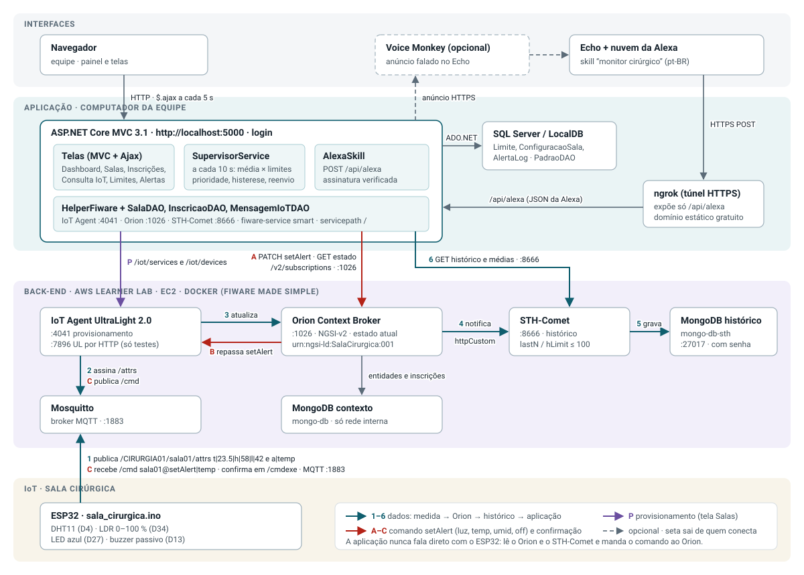

# Monitor de Sala Cirúrgica

Projeto N2 · Sistemas Embarcados (Prof. Fábio Cabrini) e Linguagem de Programação (Prof. Eduardo Rosalém) · Engenharia de Computação · FESA

> **Este documento detalha a frente de servidor.** A documentação principal — objetivo, componentes e pinagem, limites e tabela de alertas, deploy na AWS passo a passo e integrantes — está no [README.md da raiz](../README.md).

## Objetivo

Supervisionar em tempo real a temperatura, a umidade e a luminosidade de uma sala cirúrgica medidas por um ESP32, guardar o histórico e reagir a valores fora dos limites com alertas visuais e sonoros.

O ESP32 publica as medidas no FIWARE por MQTT. A aplicação ASP.NET Core:

- lê o estado atual no Orion;
- calcula as médias no STH-Comet;
- compara as médias com os limites do perfil ativo;
- quando alguma grandeza sai da faixa, manda o comando `setAlert` ao Orion, que o repassa ao ESP32.

O ESP32 então pisca o LED azul e toca o buzzer num padrão diferente para cada grandeza. A equipe também pode consultar a sala e silenciar o alarme pela **Alexa**.

## Arquitetura

Fluxo de dados (1 → 6) e de comandos (A → C). A seta parte de quem inicia a conexão.

| # | De → para | Protocolo / porta | O que passa |
| --- | --- | --- | --- |
| 1 | ESP32 → Mosquitto | MQTT :1883 | `/CIRURGIA01/sala01/attrs` · `t\|23.5\|h\|58\|l\|42` a cada 5 s e `a\|temp` quando o alerta muda |
| 2 | IoT Agent → Mosquitto | MQTT :1883 | assina `/+/+/attrs` |
| 3 | IoT Agent → Orion | HTTP :1026 | atualiza `urn:ngsi-ld:SalaCirurgica:001` (`temperature`, `humidity`, `luminosity`, `alert`) |
| 4 | Orion → STH-Comet | HTTP :8666 `/notify` | inscrição `httpCustom` (NGSIv1), uma por grandeza |
| 5 | STH-Comet → MongoDB histórico | :27017 | grava em `sth_smart` |
| 6 | Aplicação → STH-Comet | HTTP :8666 | histórico dos gráficos, médias da janela, consulta paginada |
| A | Aplicação → Orion | HTTP :1026 | `PATCH /v2/entities/{id}/attrs` com `setAlert` = `luz`, `temp`, `umid` ou `off` |
| B | Orion → IoT Agent | HTTP :4041 | repassa o comando (registro criado no provisionamento) |
| C | IoT Agent → Mosquitto → ESP32 | MQTT :1883 | `/CIRURGIA01/sala01/cmd` · `sala01@setAlert\|temp`; o ESP32 confirma em `/cmdexe` |
| P | Aplicação → IoT Agent | HTTP :4041 | `/iot/services` e `/iot/devices` (tela Salas) |

A aplicação **nunca fala direto com o ESP32**. Detalhes de cada camada em [`docs/arquitetura.md`](../docs/arquitetura.md).

## Componentes e pinagem

A lista de materiais, a pinagem completa, o divisor do LDR e a caixa impressa em 3D estão na seção **Componentes e pinagem** do [README.md da raiz](../README.md). Resumo do que o firmware usa:

| Componente | Pino | Observação |
| --- | --- | --- |
| DHT11 (DATA) | GPIO 4 | VCC no 3V3, GND no GND |
| LDR | GPIO 34 | divisor 3V3 → LDR → GPIO 34 → 10 kΩ → GND |
| LED RGB | GPIO 25 (R), 26 (G), 27 (B) | só o azul é usado; vermelho e verde ficam apagados |
| Buzzer passivo | GPIO 13 | resistor de 100 Ω em série |

Os nomes abaixo são o contrato entre firmware, FIWARE e aplicação (Guia dos desenvolvedores). A aplicação depende deles:

| Item | Valor |
| --- | --- |
| `fiware-service` / `fiware-servicepath` | `smart` / `/` |
| apikey · device_id | `CIRURGIA01` · `sala01` |
| Entidade | `urn:ngsi-ld:SalaCirurgica:001`, tipo `SalaCirurgica` |
| Atributos (UL → Orion) | `t` → `temperature` (Number, °C) · `h` → `humidity` (Number, %) · `l` → `luminosity` (Integer, 0–100 %) · `a` → `alert` (Text) |
| Comando | `setAlert` com `luz`, `temp`, `umid` ou `off` |

## Limites e alertas

### Perfis de limites

A supervisão compara a **média da janela** (padrão de 30 s, cerca de 6 medidas) com a faixa do perfil ativo da sala. Para **entrar** em alerta basta a média sair da faixa. Para **sair** do alerta, a média precisa voltar além da histerese: com máximo de 28 °C e histerese de 0,5, o alarme liga acima de 28,0 e só desliga em 27,5.

| Perfil | Temperatura | Umidade | Luminosidade | Uso |
| --- | --- | --- | --- | --- |
| **Demonstração** (padrão) | 15 a 28 °C · hist. 0,5 | 30 a 75 % · hist. 2 | 25 a 100 % · hist. 3 | Sala de aula: só a provocação dispara (aquecer/segurar o DHT11, soprar nele, cobrir o LDR) |
| **Norma NBR 7256** | 18 a 22 °C · hist. 0,5 | 45 a 55 % · hist. 2 | 60 a 100 % · hist. 5 | Faixas de referência para sala cirúrgica. A norma não trata de luz: o limite do LDR é da equipe |

Os perfis ficam na tabela `Limite` e são editados na tela **Limites**. O perfil de cada sala é escolhido na tela **Salas**. Ajuste o perfil Demonstração com os valores normais da sala medidos no Serial.

### Tabela de alertas

| Alerta | Condição | Prioridade | LED azul | Buzzer |
| --- | --- | --- | --- | --- |
| `luz` | média da luminosidade fora da faixa | 1ª | 150 ms aceso, 150 ms apagado | 2000 Hz |
| `temp` | média da temperatura fora da faixa | 2ª | 400 ms aceso, 400 ms apagado | 1000 Hz |
| `umid` | média da umidade fora da faixa | 3ª | 1 s aceso, 1 s apagado | 500 Hz |
| `off` | as três dentro da faixa | — | apagado | desligado |

O buzzer toca enquanto o LED está aceso. Com mais de uma grandeza fora, vale a de maior prioridade: com luz baixa **e** temperatura alta, a placa mostra `luz`. Quando as três voltam à faixa, LED e buzzer desligam.

## Aplicação (Analista 1)

ASP.NET Core MVC em [`MonitorSalaCirurgica/`](MonitorSalaCirurgica): solução `MonitorSalaCirurgica.sln` com o projeto ao lado, **no mesmo padrão do CadAlunoMVC e da apostila de LP I**.

| Item | Escolha |
| --- | --- |
| .NET | `netcoreapp3.1`, com `Program.cs`, `Startup.cs` e Session (login `admin` / `1234`) |
| Pacotes | Os do CadAluno: RuntimeCompilation 3.1.32, CodeGeneration.Design 3.1.5, Newtonsoft.Json 13.0.3 e System.Data.SqlClient 4.8.5 |
| Front-end | Bootstrap 4.3.1 e jQuery 3.5.1 (as versões do CadAluno), mais o Chart.js para os gráficos |
| JavaScript | Todo no `site.js`, com `$.ajax` como nos capítulos 36 e 37 |
| C# | Síncrono, como na apostila: `HttpClient` com `.Result` e proxy opcional (cap. 37) |

### O que cada professor avalia e onde está

| Pedido | Tela | Como |
| --- | --- | --- |
| LP · CRUDs direto no FIWARE via API (5,0) | **Salas** e **Inscrições** | `PadraoFiwareController` + `SalaDAO` (IoT Agent `/iot/devices`) e `InscricaoDAO` (Orion `/v2/subscriptions`) |
| LP · Consulta das mensagens IoT via API e AJAX (2,0) | **Consulta IoT** | Consulta avançada do cap. 36: `ExibeConsultaAvancada`, `ObtemDadosConsultaAvancada` e a partial view `pvGridMensagens`, paginada pela API do STH-Comet |
| LP · Dois gráficos em dashboard (3,0) | **Dashboard** | Gráfico 1: linhas por grandeza com os limites. Gráfico 2: histograma das leituras com as faixas fora do limite em vermelho |
| LP · Modelo de dados e SQL | **Limites**, **Alertas** | Tabelas `Limite`, `ConfiguracaoSala` e `AlertaLog` com stored procedures (`database/script.sql`) |
| SE · H2 FIWARE e dispositivo provisionado | **Salas**, **Conexão** | Grupo de serviço e dispositivo criados pela tela; health check dos três componentes |
| SE · H3 Tempo real | **Dashboard** | Cartões e faixa do alerta atualizados por AJAX a cada 5 s, sem recarregar |
| SE · H4 Histórico | **Dashboard**, **Consulta IoT** | Gráficos alimentados pela API do STH-Comet (dados no MongoDB) |
| SE · H5 Triggers e alertas | `SupervisorService` | Médias × limites → `setAlert` ao ESP32; testes por grandeza na tela Salas |
| SE · D4 Código do front-end | todo o projeto | Endpoints, médias, limites e comandos comentados |

### Telas

| Tela | O que faz | Chamadas ao FIWARE |
| --- | --- | --- |
| **Início** | Situação de cada sala e dos três componentes do FIWARE | `GET /v2/entities/{id}` e `/version` |
| **Dashboard** | Valor atual e média de cada grandeza, faixa do alerta com LED virtual, silenciar/reativar, gráfico de linhas (5 min a 24 h), histograma e resumo do período | Orion (estado) e STH-Comet (bruto até 30 min; acima, média por minuto com `aggrMethod=sum`) |
| **Salas** | CRUD das salas + configuração (nome, perfil, janela, supervisão) e botões para testar cada alerta | `POST /iot/services`, `GET/POST /iot/devices`, `PUT/DELETE /iot/devices/{id}`, `PATCH` setAlert |
| **Inscrições** | CRUD das inscrições Orion → STH-Comet, uma por grandeza (formato 2.6, `httpCustom`), sem duplicar | `GET/POST /v2/subscriptions`, `PATCH/DELETE /v2/subscriptions/{id}` |
| **Consulta IoT** | Medidas por sala, grandeza e período, paginadas | `GET /STH/v1/...?dateFrom&dateTo&hLimit&hOffset&count=true` |
| **Limites** | CRUD da tabela `Limite` (perfis), com código gerado por `spProximoId` como no CadAluno | — |
| **Alertas** | Histórico de cada `setAlert` (tabela `AlertaLog`), com filtros | — |
| **Alexa** | Simulador da skill e teste dos anúncios | — |
| **Conexão** | Health check dos três componentes e troca do IP da EC2 sem reiniciar | `GET /version`, `GET /iot/about` |

### Supervisão automática (critério H5)

O [`SupervisorService`](MonitorSalaCirurgica/Services/SupervisorService.cs) roda em segundo plano. A cada 10 s, para cada sala do IoT Agent:

1. **Média da janela**: busca no STH-Comet as medidas de `agora − janela` até agora e calcula a média. Sem pontos na janela, usa o valor atual do Orion.
2. **Limites**: compara cada média com a faixa do perfil ativo, com histerese ([`AnaliseSala`](MonitorSalaCirurgica/Services/AnaliseSala.cs)).
3. **Prioridade**: escolhe `luz` > `temp` > `umid`, ou `off` se tudo está normal.
4. **Comando**: envia `setAlert` **só quando o alerta muda** ([`Alarme`](MonitorSalaCirurgica/Services/Alarme.cs)).
5. **Confirmação**: se o atributo `alert` do Orion (publicado pelo ESP32) não ficar igual em 10 s, reenvia.
6. **Registro**: grava tudo no `AlertaLog` (Enviado → Confirmado, Reenviado ou Falha).

O **teste** (botão ou Alexa, 15 s) e o **silêncio** (1 a 30 min) passam na frente do cálculo enquanto valem. Depois, a supervisão volta sozinha.

### Organização do código (equivalência com o CadAluno)

| Arquivo | Papel | Equivale no CadAluno a |
| --- | --- | --- |
| `DAO/ConexaoBD.cs`, `DAO/HelperDAO.cs`, `DAO/PadraoDAO.cs` | Acesso ao SQL Server por stored procedures | os mesmos arquivos |
| `DAO/LimiteDAO.cs`, `ConfiguracaoSalaDAO.cs`, `AlertaLogDAO.cs` | Tabelas do banco | `AlunoDAO`, `CidadeDAO` |
| `DAO/ConfigFiware.cs` | Endereço, portas, `fiware-service` e proxy (lidos do appsettings.json) | `ConexaoBD` |
| `DAO/HelperFiware.cs` | Executa as chamadas às APIs do FIWARE (cap. 37) e traduz os erros | `HelperDAO` |
| `DAO/PadraoFiwareDAO.cs` | CRUD genérico de um recurso do FIWARE: a URL da coleção faz o papel da tabela | `PadraoDAO` |
| `DAO/SalaDAO.cs`, `InscricaoDAO.cs` | Salas no IoT Agent e inscrições no Orion | `AlunoDAO` |
| `DAO/EntidadeSalaDAO.cs`, `MensagemIoTDAO.cs` | Estado e comando no Orion; histórico no STH-Comet | – |
| `Controllers/PadraoController.cs` | Index, Create, Save(model, Operacao), Edit, Delete, ValidaDados (SQL) | `PadraoController` |
| `Controllers/PadraoFiwareController.cs` | O mesmo para os CRUDs no FIWARE (chave texto) | `PadraoController` |
| `Controllers/BaseController.cs`, `HelperControllers.cs`, `LoginController.cs` | Login por sessão (`OnActionExecuting`) | os mesmos |
| `Controllers/SalaController.cs`, `InscricaoController.cs`, `LimiteController.cs` | CRUDs | `AlunoController`, `CidadeController` |
| `Controllers/MensagemController.cs` + `Views/Mensagem/pvGridMensagens.cshtml` | Consulta via AJAX com partial view | consulta avançada do cap. 36 |
| `Controllers/DashboardController.cs` | Dashboard e JSON para os gráficos | – |
| `Services/` | Supervisão automática (`SupervisorService`, `AnaliseSala`, `Alarme`) e Alexa | – |
| `Views/<Tela>/Index.cshtml` e `Form.cshtml` | Listagem e formulário (`action="Save"`, `ViewBag.Operacao`, `asp-validation-for`, código só leitura na alteração) | mesmas views |
| `wwwroot/js/site.js` | Todas as funções javascript (`apagarRegistro`, `aplicaFiltroConsultaAvancada`, dashboard, simulador da Alexa) | `site.js` |

## Banco de dados (Analista 1)

[`database/script.sql`](../database/script.sql) cria o banco `MonitorSalaCirurgica`. Pode ser executado de novo: apaga e recria tudo.

| Tabela | Conteúdo |
| --- | --- |
| `Limite` | Faixa (mínimo, máximo, histerese) de cada grandeza por perfil; código gerado por `spProximoId`; `UNIQUE (Perfil, Grandeza)` |
| `ConfiguracaoSala` | Para cada `device_id`: nome, perfil ativo, janela da média (10–3600 s), supervisão ligada |
| `AlertaLog` | Cada comando: data e hora, sala, alerta, origem (Supervisão, Teste, Alexa, Silêncio), motivo, situação |

Procedures no padrão do CadAluno: `spInsert_<Tabela>`, `spUpdate_<Tabela>`, `spDelete`, `spConsulta`, `spListagem` e `spProximoId` (genéricas), além de `spListagemLimitesPorPerfil`, `spListagemPerfis`, `spConsultaConfiguracaoPorDevice` e `spConsultaAvancadaAlertas`.

## FIWARE na AWS

O FIWARE roda numa EC2 do AWS Learner Lab com o [FIWARE Descomplicado](https://github.com/fabiocabrini/fiware): Orion 3.11.0, IoT Agent UltraLight, STH-Comet, Mosquitto e dois MongoDB (contexto na rede interna e histórico com senha). O passo a passo completo do deploy, do zero, está em [`docs/deploy-learner-lab.md`](../docs/deploy-learner-lab.md).

O que a aplicação precisa da EC2:

- **Security Group**: liberar só as portas usadas.
  - 1883: ESP32
  - 1026, 4041 e 8666: aplicação
  - 22: só o IP da equipe
  - 7896: só enquanto testar sem hardware
- **IP público**: muda a cada sessão. Atualize em **Conexão** (ou `Fiware:Host` no `appsettings.json`) e no `secrets.h` do firmware.

Duas diferenças do FIWARE Made Simple que a aplicação já trata:

- **Inscrições em `httpCustom`**: o Orion 4 não tem mais `attrsFormat: legacy`, e o STH-Comet só entende NGSIv1. A tela Inscrições cria as inscrições no mesmo formato da requisição 2.6.
- **Paginação do STH-Comet**: `lastN` e `hLimit` aceitam no máximo 100. A aplicação pagina com `hOffset`.

## Alexa

Skill personalizada **"monitor cirúrgico"** (pt-BR). Exemplos:

- "Alexa, pergunte ao monitor cirúrgico como está a sala."
- "Alexa, pergunte ao monitor cirúrgico se tem algum alerta."
- "Alexa, peça ao monitor cirúrgico para silenciar o alarme por cinco minutos."

A skill pede confirmação antes de silenciar. Ela usa os mesmos dados do dashboard e, como o resto da aplicação, só fala com o Orion. Opcionalmente, o Echo **anuncia sozinho** quando a supervisão dispara um alerta. Configuração, túnel HTTPS (ngrok) e segurança em [`docs/alexa.md`](../docs/alexa.md).

## Como executar a aplicação

Requisitos: Visual Studio 2019 ou 2022 com o **SDK do .NET Core 3.1** (o mesmo do CadAluno) e o SQL Server LocalDB. No VS 2022, se o projeto não abrir, instale o componente ".NET Core 3.1" no Visual Studio Installer.

1. **Banco**: abra `../database/script.sql` no Visual Studio (Pesquisador de Objetos do SQL Server › `(localdb)\MSSQLLocalDB` › Nova Consulta) e execute.
2. **Configuração**: copie `MonitorSalaCirurgica/appsettings.example.json` para `appsettings.json` (fica fora do GitHub) e preencha `Fiware:Host` com o IP público da EC2. Se o banco não for o LocalDB, ajuste `ConnectionStrings:BancoSQL`.
3. **Executar**: abra `app/MonitorSalaCirurgica.sln` e rode com F5 (perfil **MonitorSalaCirurgica**, em `http://localhost:5000`). Entre com `admin` / `1234`.
4. **Conferir**: em **Conexão**, os três componentes devem aparecer em verde com a versão.
5. **Cadastrar a sala**: em **Salas › Novo registro**, mantenha `sala01`, `urn:ngsi-ld:SalaCirurgica:001` e `CIRURGIA01` e deixe marcado "Criar as três inscrições". Se a sala já foi cadastrada pelo Postman, ela aparece na lista e entra na supervisão automaticamente.
6. **Ver funcionando**: com o ESP32 ligado, o **Dashboard** mostra os valores mudando sozinhos. Provoque uma condição e o alarme dispara em até cerca de 40 s (janela de 30 s + ciclo de 10 s).

Sem hardware, simule uma medida com a requisição 3.1 da coleção do FIWARE Made Simple (porta 7896), usando `k=CIRURGIA01`, `i=sala01` e o corpo `t|25|h|55|l|40`.

## Integrantes

| Nome | RA |
| --- | --- |
| André Felipe Teixeira Gomes | 082240018 |
| Arthur Marassatto | 082240025 |
| Danilo Spinola Mota Batista | 082240002 |
| Enzo Molinari Ferreira | 082240003 |
| Guilherme Eidi Tiba | 082240026 |

Frentes do Guia dos desenvolvedores: **servidor** (aplicação ASP.NET Core, banco SQL, FIWARE na AWS e diagrama da arquitetura) e **dispositivo** (firmware do ESP32, circuito, montagem e caixa). A lista completa está no [README.md da raiz](../README.md).
