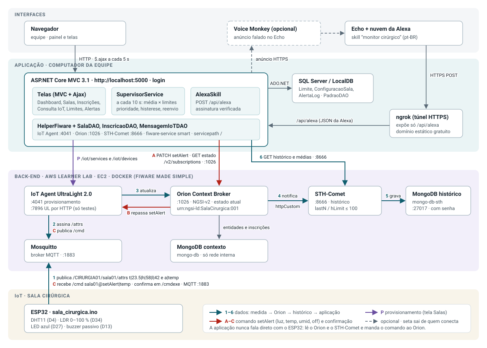

# Arquitetura

O sistema segue o padrão do FIWARE Made Simple: cada seta parte de quem inicia a conexão, e a aplicação **nunca fala direto com o ESP32**. Ela lê o estado no Orion, consulta o histórico no STH-Comet e envia o comando ao Orion, que o repassa ao IoT Agent e ao ESP32 por MQTT.

## Camadas

| Camada | Onde roda | Componentes | Portas |
| --- | --- | --- | --- |
| IoT | Sala cirúrgica | ESP32 com DHT11 (D4), LDR (D34), LED azul (D27) e buzzer passivo (D13) | cliente MQTT → 1883 |
| Back-end | EC2 do AWS Learner Lab, Docker (FIWARE Made Simple) | Mosquitto, IoT Agent UltraLight, Orion, STH-Comet, MongoDB de contexto (rede interna) e MongoDB de histórico (com senha) | 1883, 4041, 7896 (só testes), 1026, 8666, 27017 |
| Aplicação | Computador da equipe | ASP.NET Core MVC 3.1 em camadas (telas, SupervisorService, skill da Alexa) e SQL Server / LocalDB | 5000 (local) |
| Interfaces | Navegador e Echo | Dashboard e telas; skill da Alexa pela nuvem da Amazon e túnel ngrok; anúncios opcionais (Voice Monkey) | HTTPS 443 |

## Dados: da medida ao gráfico

| Passo | Quem → quem | Como |
| --- | --- | --- |
| 1 | ESP32 → Mosquitto | publica `t\|23.5\|h\|58\|l\|42` em `/CIRURGIA01/sala01/attrs` a cada 5 s |
| 2 | IoT Agent → Mosquitto | assina os tópicos `attrs` e traduz UltraLight → NGSI-v2 |
| 3 | IoT Agent → Orion | atualiza `temperature`, `humidity`, `luminosity` (e `alert`) na entidade `urn:ngsi-ld:SalaCirurgica:001` |
| 4 | Orion → STH-Comet | a cada atualização, notifica `http://sth-comet:8666/notify`; uma inscrição por grandeza em `httpCustom` (NGSIv1) |
| 5 | STH-Comet → MongoDB | grava a série em `sth_smart` e calcula as agregações por minuto, hora e dia |
| 6 | Aplicação → STH-Comet | painel (gráficos), consulta paginada e média da janela da supervisão |

## Comandos: da média ao buzzer

| Passo | Quem → quem | Como |
| --- | --- | --- |
| — | SupervisorService | a cada 10 s: média da janela × limites do perfil (com histerese) → alerta pela prioridade `luz` > `temp` > `umid` |
| A | Aplicação → Orion | `PATCH /v2/entities/urn:ngsi-ld:SalaCirurgica:001/attrs` com `{"setAlert": {"type": "command", "value": "temp"}}`, só quando o alerta muda |
| B | Orion → IoT Agent | o IoT Agent é o provedor do comando (registro criado ao provisionar o dispositivo) |
| C | IoT Agent → ESP32 | publica `sala01@setAlert\|temp` em `/CIRURGIA01/sala01/cmd`. O ESP32 liga o padrão, publica `a\|temp` em `attrs` e confirma `sala01@setAlert\|ok temp` em `cmdexe` |
| — | Aplicação | confere o atributo `alert` no Orion; se não ficar igual ao enviado em 10 s, reenvia. Tudo vai para o `AlertaLog` |

## Provisionamento

A tela **Salas** (`SalaDAO`) faz o que as requisições 2.1 e 2.3 da coleção fazem pelo Postman:

- `POST /iot/services`: grupo do apikey `CIRURGIA01`;
- `POST /iot/devices`: atributos `t`, `h`, `l`, `a` e o comando `setAlert`.

A tela **Inscrições** (`InscricaoDAO`) faz o mesmo que a requisição 2.6, uma inscrição para cada grandeza.

## Alexa

| De → para | Como |
| --- | --- |
| Echo → nuvem da Alexa | voz; a Amazon reconhece o intent (modelo `alexa/skill-package/interactionModels/custom/pt-BR.json`) |
| Nuvem da Alexa → ngrok → aplicação | `POST /api/alexa` em HTTPS, assinado pela Amazon (a aplicação confere certificado, assinatura, horário e ID da skill) |
| Aplicação → Orion / STH-Comet | a mesma `AnaliseSala` do dashboard. Para silenciar ou testar, a mesma classe `Alarme` (passo A) |
| Aplicação → Voice Monkey → Echo | opcional: anúncio falado quando a supervisão dispara ou encerra um alerta |
